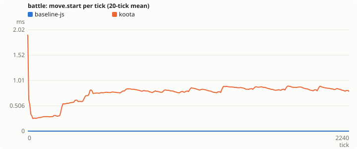

# Bench results

Generated by `pnpm bench <target> <scenario...> --record` (or `pnpm results`). Do not edit by hand.
Raw data: [`bench-data/summary.csv`](../bench-data/summary.csv) (one row per commit, target and scenario) and `bench-data/ticks/<scenario>/<target>.csv` (per-tick median of the runs).
Totals, p99 and max tick are the median of the headline runs, which time whole ticks only. Phase, GC, allocation and heap data come from deep-dive runs, which add timers and a GC profiler. GC ms is V8 GC pause time inside the timed ticks. Alloc MB is JS heap bytes allocated (heap growth plus bytes the GC freed). It excludes typed-array backing stores.

## Headline score

Geometric mean over the scenarios of target total ms divided by `baseline-js` total ms, from matched runs. The interval is a 95% percentile bootstrap. Targets whose intervals overlap share a rank.

| rank | target | score | 95% interval |
|---|---:|---:|---:|
| 1 | koota | 8.837 | 8.794 to 8.913 |

## battle

### Totals for the run

| metric | baseline-js (938bef3) | koota (938bef3) |
|---|---:|---:|
| total ms | 6350.88 | 56120.45 |
| total ms 95% interval | 6338.42 to 6371.51 | 55951.48 to 56643.74 |
| p99 tick ms | 6.15 | 85.44 |
| max tick ms | 8.65 | 792.93 |
| ticks over 16.6 ms | 0 | 1890 |
| spawn ms | 209.56 | 2535.9 |
| ai/target ms | 1943.02 | 5605.62 |
| move.start ms | 0.27 | 1775.78 |
| move ms | 1428.01 | 12443.01 |
| combat ms | 604.1 | 8748.31 |
| effects ms | 37.44 | 238.96 |
| morale ms | 124.77 | 460.96 |
| cleanup ms | 741.13 | 2999.2 |
| objectives ms | 44.96 | 145.8 |
| stats ms | 1115.9 | 10646.46 |
| gc ms | 107.14 | 870.26 |
| alloc MB | 4090.67 | 40410.26 |
| peak heap MB | 269.01 | 1177.41 |

### Mean for each tick

| metric | baseline-js | koota |
|---|---:|---:|
| tick ms | 2.766 | 19.895 |
| spawn ms | 0.092 | 1.106 |
| ai/target ms | 0.864 | 2.406 |
| move.start ms | 0.000 | 0.753 |
| move ms | 0.627 | 5.345 |
| combat ms | 0.268 | 3.769 |
| effects ms | 0.017 | 0.103 |
| morale ms | 0.055 | 0.194 |
| cleanup ms | 0.312 | 1.312 |
| objectives ms | 0.020 | 0.063 |
| stats ms | 0.495 | 4.588 |
| gc ms | 0.034 | 0.135 |
| alloc KB | 1873.4 | 18339.5 |

### Per tick

