# Bench results

Generated by `pnpm bench <target> <scenario...> --record` (or `pnpm results`). Do not edit by hand.
Raw data: [`bench-data/summary.csv`](../bench-data/summary.csv) (one row per commit, target and scenario) and `bench-data/ticks/<scenario>/<target>.csv` (per-tick median of the runs).
Totals are the median of the runs. GC ms is V8 GC pause time inside the timed ticks. Alloc MB is JS heap bytes allocated (heap growth plus bytes the GC freed). It excludes typed-array backing stores.

## battle

### Totals for the run

| metric | baseline-js (a4a57f2) | koota (d3d9b96) |
|---|---:|---:|
| total ms | 2843.74 | 13903.48 |
| spawn ms | 62.79 | 358.48 |
| ai/target ms | 1046.97 | 3106.48 |
| move ms | 534.05 | 3625.32 |
| combat ms | 267.96 | 3888.95 |
| effects ms | 58.79 | 120.12 |
| morale ms | 183.22 | 181.81 |
| cleanup ms | 372.57 | 1626.24 |
| objectives ms | 106.7 | 735.02 |
| stats ms | 191.53 | 190.93 |
| gc ms | 22.44 | 313.91 |
| alloc MB | 2886.9 | 24313.68 |
| peak heap MB | 51.76 | 337.04 |

### Mean for each tick

| metric | baseline-js | koota |
|---|---:|---:|
| tick ms | 1.361 | 6.469 |
| spawn ms | 0.030 | 0.168 |
| ai/target ms | 0.505 | 1.432 |
| move ms | 0.255 | 1.679 |
| combat ms | 0.128 | 1.806 |
| effects ms | 0.029 | 0.053 |
| morale ms | 0.084 | 0.081 |
| cleanup ms | 0.175 | 0.735 |
| objectives ms | 0.051 | 0.330 |
| stats ms | 0.088 | 0.085 |
| gc ms | 0.003 | 0.092 |
| alloc KB | 1481.8 | 12227.2 |

### Per tick

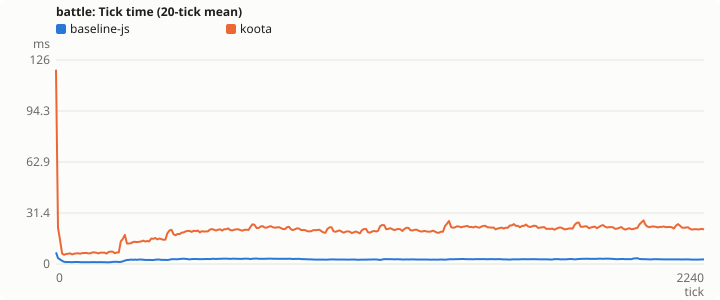
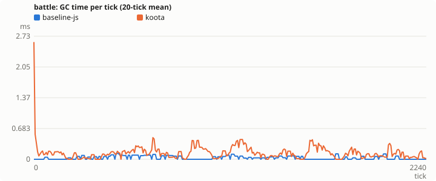
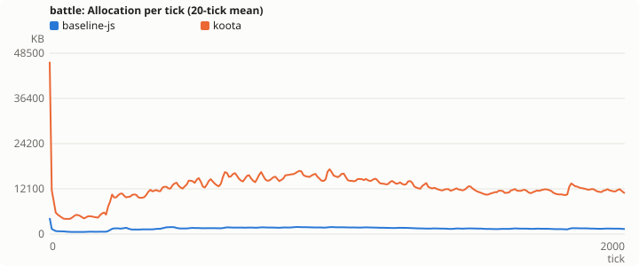
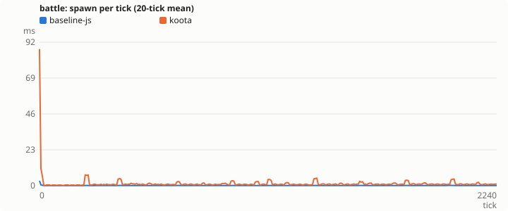
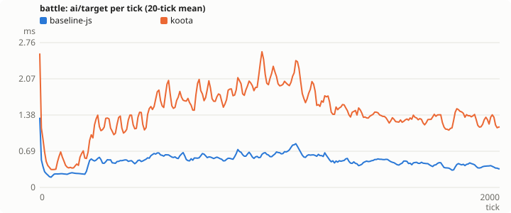
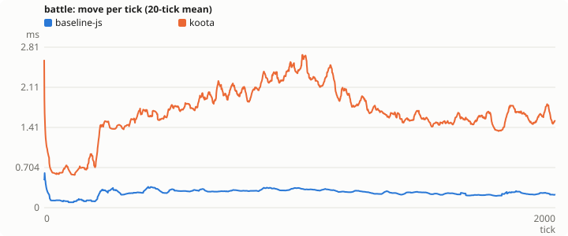
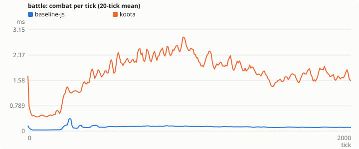
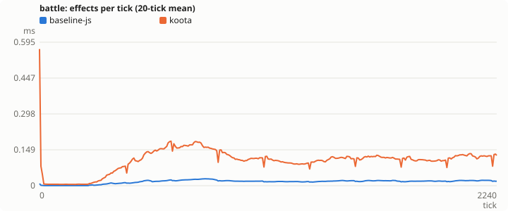
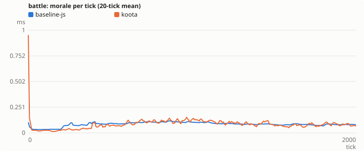
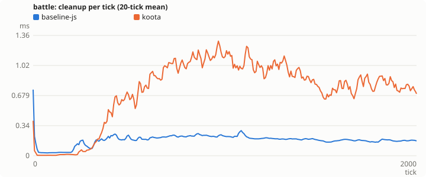
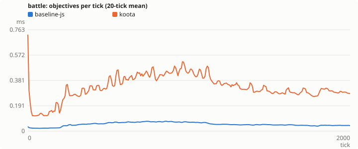
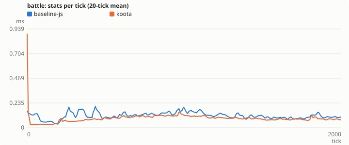

## skirmish

### Totals for the run

| metric | baseline-js (a4a57f2) | koota (d3d9b96) |
|---|---:|---:|
| total ms | 370.69 | 1244.74 |
| spawn ms | 10.94 | 41.55 |
| ai/target ms | 83.68 | 221.85 |
| move ms | 74.05 | 365.87 |
| combat ms | 46.28 | 343.73 |
| effects ms | 7.22 | 12.51 |
| morale ms | 22.37 | 16.31 |
| cleanup ms | 65.18 | 121.57 |
| objectives ms | 26 | 91.65 |
| stats ms | 22.47 | 20.49 |
| gc ms | 5.9 | 22.47 |
| alloc MB | 475.14 | 2878.56 |
| peak heap MB | 19.96 | 36.36 |

### Mean for each tick

| metric | baseline-js | koota |
|---|---:|---:|
| tick ms | 0.166 | 0.589 |
| spawn ms | 0.005 | 0.020 |
| ai/target ms | 0.038 | 0.102 |
| move ms | 0.032 | 0.174 |
| combat ms | 0.020 | 0.161 |
| effects ms | 0.004 | 0.006 |
| morale ms | 0.009 | 0.008 |
| cleanup ms | 0.026 | 0.056 |
| objectives ms | 0.011 | 0.042 |
| stats ms | 0.011 | 0.009 |
| gc ms | 0.001 | 0.003 |
| alloc KB | 241.0 | 1462.7 |

### Per tick

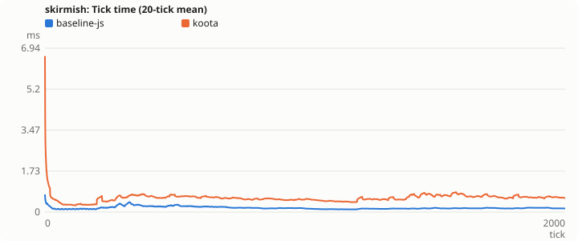
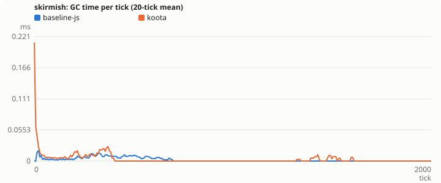
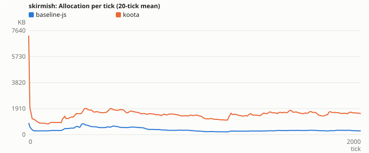
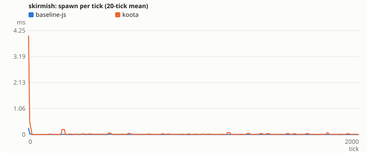
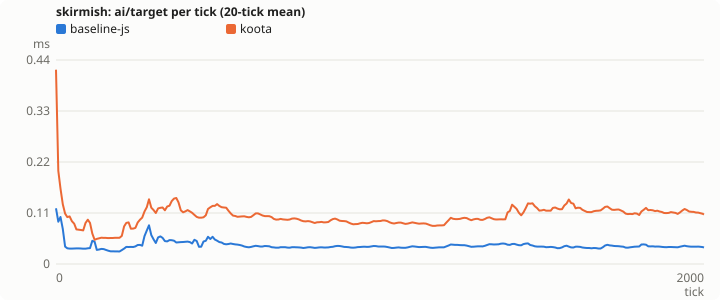
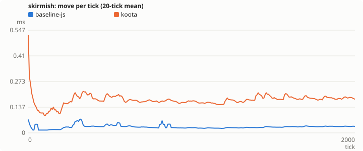
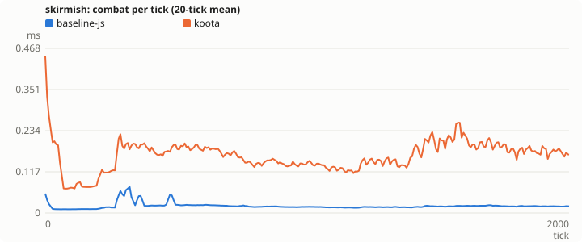
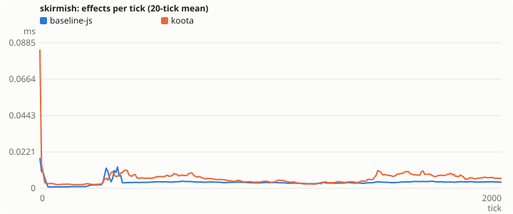
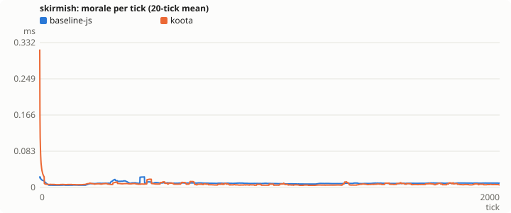
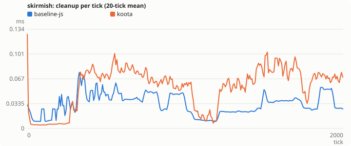
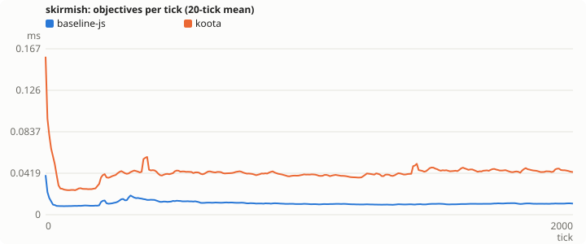
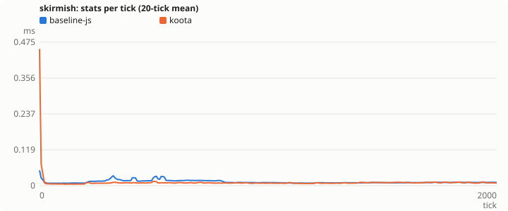

## war

### Totals for the run

| metric | baseline-js (a4a57f2) | koota (d3d9b96) |
|---|---:|---:|
| total ms | 14553.42 | 37948.61 |
| spawn ms | 181.17 | 877.92 |
| ai/target ms | 8959.95 | 12640.77 |
| move ms | 1655.37 | 9177.04 |
| combat ms | 843.66 | 8796.18 |
| effects ms | 203.81 | 237.26 |
| morale ms | 604.14 | 498.23 |
| cleanup ms | 1162.36 | 3518.36 |
| objectives ms | 290.82 | 1744.64 |
| stats ms | 791.45 | 408.23 |
| gc ms | 182.29 | 885.8 |
| alloc MB | 6635.16 | 55313.82 |
| peak heap MB | 119.66 | 808.91 |

### Mean for each tick

| metric | baseline-js | koota |
|---|---:|---:|
| tick ms | 14.321 | 37.146 |
| spawn ms | 0.170 | 0.848 |
| ai/target ms | 8.822 | 12.416 |
| move ms | 1.579 | 8.970 |
| combat ms | 0.798 | 8.546 |
| effects ms | 0.191 | 0.231 |
| morale ms | 0.537 | 0.473 |
| cleanup ms | 1.066 | 3.442 |
| objectives ms | 0.260 | 1.633 |
| stats ms | 0.776 | 0.382 |
| gc ms | 0.068 | 0.805 |
| alloc KB | 6822.3 | 55805.6 |

### Per tick

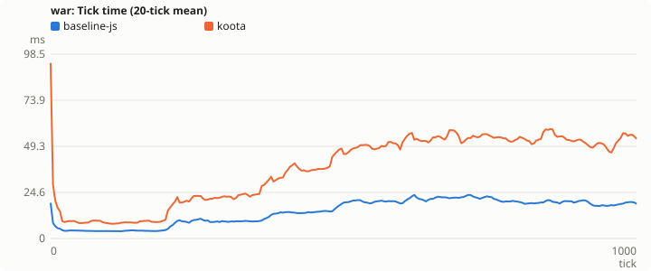
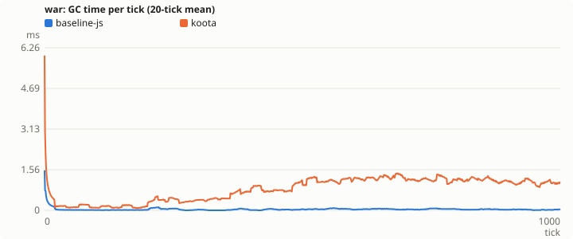
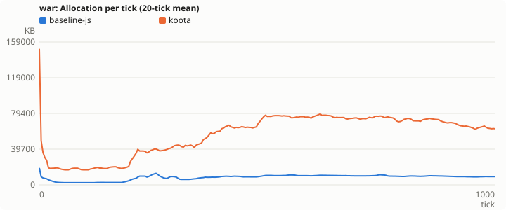
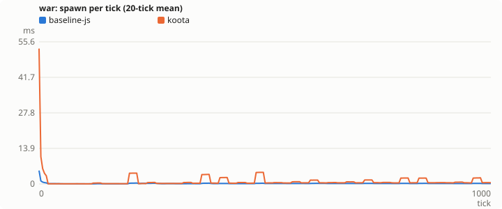
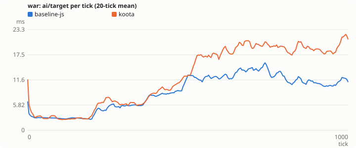
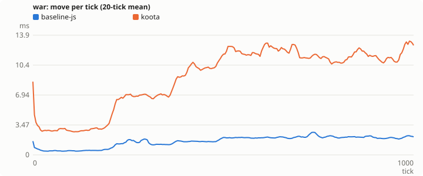
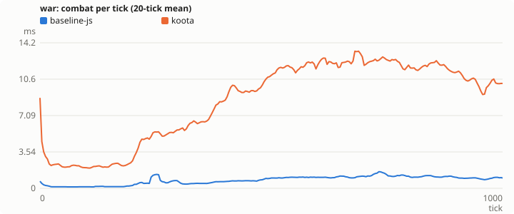
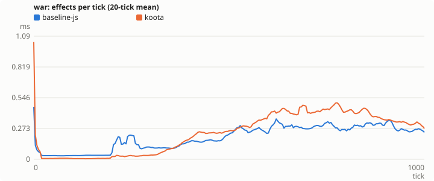
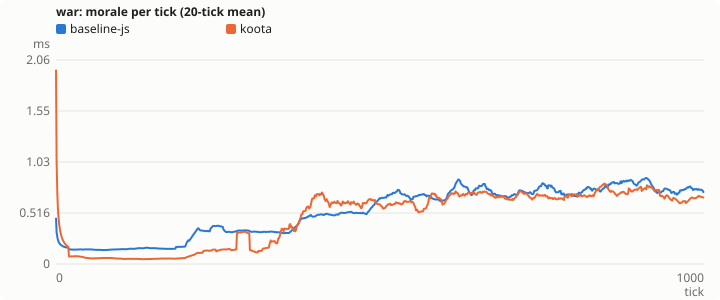
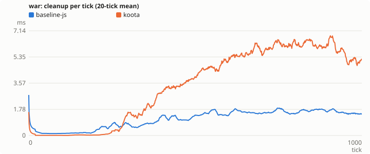
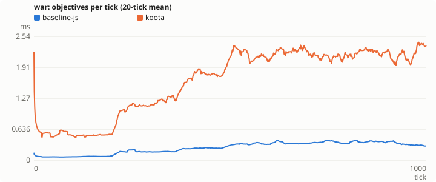
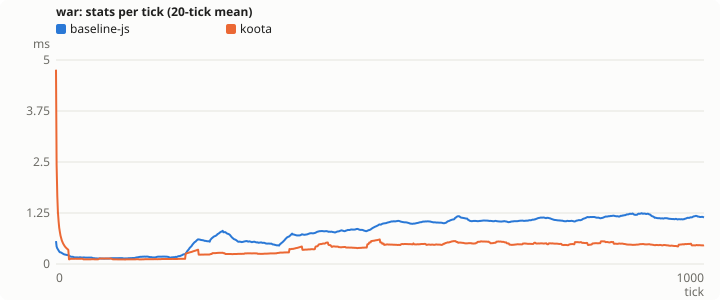
